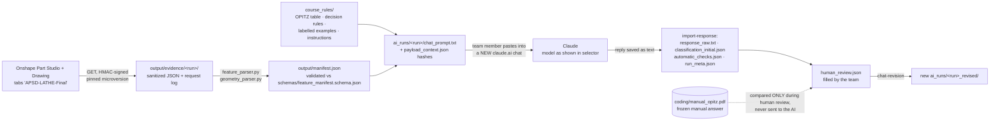

# APSD-LATHE — Part C, Path B: Onshape API → manifest.json → Claude

This folder contains the team's executable CAD-to-AI workflow for Assignment 1, Part C, Path B (brief *APSD.Part 00. Fall 2026 MAIN Project-P1*, §1.6, Q4–Q6):

```
Onshape document ──(read-only API GET)──▶ Onshape JSON responses
   ──(Python parsers)──▶ manifest.json (validated) ──▶ chat_prompt.txt (exact AI input)
   ──(team member pastes it into a NEW claude.ai chat)──▶ Claude's JSON reply
   ──(import-response: validate + archive)──▶ classification_initial.json ──▶ human review
   ──▶ optional revised run (new folder)
```

**AI choice:** Anthropic Claude through the **claude.ai web chat**. The handoff to the chat is manual: the script prepares the exact text, a person pastes it and saves the reply, and the script validates and archives that reply. The brief (§1.6.1) names Claude as an option and states that a paid API is not required. The code also contains an automated OpenAI Responses API path, which the team does **not** use (see [§8](#8-alternative-openai-api-not-used)).

> **Current status (2026-11-11).**
> * **Target:** the Part Studio tab **APSD-LATHE-Final** (`147da5f19a2ac767328e5f7f`) and the drawing tab **APSD-LATHE-Final** (`39fec93b315c33208dd4a282`) of the team document, as instructed by the team. Earlier runs used the tab now named "WIP"; they stay archived.
> * Authenticated extraction works: all 11 calls returned HTTP 200. `manifest.json` is built from evaluated geometry and cross-checked against the feature list.
> * **No Claude run has been made yet.** See [§6](#6-what-has-run-and-what-is-pending).

---

## 1. Architecture



| Stage | Command | Writes |
|---|---|---|
| 1 Extract | `python -m apsd_pipeline extract` | `output/evidence/<run>/*.json`, `extraction_record.json` |
| 2 Manifest | `python -m apsd_pipeline manifest` | `output/manifest.json` (schema-validated) |
| 3 Prompt | `python -m apsd_pipeline chat-prompt` | `output/ai_runs/<run>_claude_chat_initial/chat_prompt.txt` |
| 4 Ask Claude | done by a person on claude.ai | reply saved as a text file |
| 5 Import | `python -m apsd_pipeline import-response <run_dir> <reply.txt> --model "…" --operator "…"` | `response_raw.txt`, `classification_initial.json`, `automatic_checks.json`, `run_meta.json`, `human_review.json` |
| 6 Revise | `python -m apsd_pipeline chat-revision <run_dir>`, then paste and import again | new `<run>_claude_chat_revised/` with `classification_revised.json` |

## 2. Setup

You need Python 3.10 or newer. Run these from the repository root:

```bash
cd pipeline
python3 -m venv .venv                 # private Python environment for this project
source .venv/bin/activate             # Windows: .venv\Scripts\activate
pip install -r requirements.txt
cp .env.example .env                  # .env is git-ignored; never commit it
```

**Onshape keys** (needed for full geometry). In Onshape, click your user icon (top right) → *My account* → *Developer* (left list) → *API keys* → *Create new API key*. Give it a name, tick only the permission to **read your documents**, and click *Create API key*. Copy the access key and the secret key from the pop-up **before** you click *Close*; the secret is never shown again. Put both into `ONSHAPE_ACCESS_KEY` and `ONSHAPE_SECRET_KEY` in `pipeline/.env`. Source: <https://cad.onshape.com/help/Content/Plans/developer-myaccount.htm>. The key must belong to an account that can open the team document on `cad.onshape.com`. **Never paste keys into chat, code, notebooks or commits**, and that includes the Claude chat.

The Claude chat path needs **no AI key**; you only need a claude.ai account.

Check what is configured. This prints *set / not set*, never the values:

```bash
python -m apsd_pipeline check-env
```

## 3. Run

```bash
python -m apsd_pipeline extract            # signed API-key requests (default)
python -m apsd_pipeline manifest           # builds + validates output/manifest.json
python -m apsd_pipeline chat-prompt        # writes the exact prompt and prints the next steps
```

Then send the prompt to Claude:

1. Open a **new** conversation on <https://claude.ai>. Do **not** use a Project, attached files or an earlier chat, so that Claude sees nothing except the prompt. This matters because the team's manual answer must not reach the AI.
2. Write down the **model name shown in the model selector** and the date.
3. Paste the entire `chat_prompt.txt` as one message (about 52,000 characters; claude.ai may show it as a pasted attachment, which is fine). Send it.
4. Copy Claude's complete reply, unedited, into `reply.txt` in the run folder.
5. Import it:

   ```bash
   python -m apsd_pipeline import-response output/ai_runs/<run> output/ai_runs/<run>/reply.txt \
       --model "<model name from the selector>" --operator "<your name>"
   ```

6. Optionally, use the chat's *Share* link as a record: add `--conversation-ref "<link>"`. Don't share a chat that contains anything private.

`import-response` keeps the reply byte-for-byte in `response_raw.txt` and extracts the JSON. If Claude wrapped the JSON in a code fence or added text around it, the import records that in `run_meta.json`. It then checks the structure and evidence references and writes a blank `human_review.json`. An unparseable reply is recorded as `invalid_json`, and nothing is invented. A run folder that already has an imported reply is never overwritten.

**Preflight.** `chat-prompt` stops while any of these is open:
- no labelled example;
- the course-table transcription is unverified;
- the decision rules are unapproved.

Fix them, or add `--allow-preflight-gaps` to proceed; the gaps are then recorded in `payload_context.json` as accepted deviations.

**Revision (Part D).** Fill `human_review.json`, including `feedback_to_ai` for the digits you want Claude to reconsider. Run `python -m apsd_pipeline chat-revision <run_dir>` and paste `revision_prompt.txt` into the **same** conversation. Then import the reply into the new run folder that command created. The first run stays unchanged.

`extract --auth anonymous` works without keys, but only for what the document's link sharing exposes. For this document that is the document, the elements and the feature list (observed).

Offline tests need no network and no keys: `python -m pytest -q`.

### Option: Google Colab

Colab only runs the Python steps; Claude is still used in a separate browser tab. Store the Onshape keys in Colab's **Secrets** panel (key icon) as `ONSHAPE_ACCESS_KEY` and `ONSHAPE_SECRET_KEY`, then run:

```python
!git clone https://github.com/alexkhovrenkov/APSD_Project_2026.git   # private repo? upload the pipeline folder instead
%cd APSD_Project_2026/pipeline
!pip install -q -r requirements.txt

import os
from google.colab import userdata
for name in ["ONSHAPE_ACCESS_KEY", "ONSHAPE_SECRET_KEY"]:
    try:
        os.environ[name] = userdata.get(name)      # stays in memory, never printed
    except Exception:
        print(name, "not set in Colab Secrets")

!python -m apsd_pipeline extract
!python -m apsd_pipeline manifest
!python -m apsd_pipeline chat-prompt
```

Download `chat_prompt.txt` from the Files panel and paste it into claude.ai. Upload `reply.txt` to the same run folder, then run `!python -m apsd_pipeline import-response …`. Download `output/` at the end, because Colab files disappear when the session ends. No team notebook was inspected for this pipeline; the cells above are a suggested starting point.

## 4. What the code does (and does not do)

**Onshape access (`onshape_client.py`, `extract.py`)**
* Uses request signing as documented at <https://onshape-public.github.io/docs/auth/apikeys/>: headers `Date`, `On-Nonce` and `Authorization: On <AccessKey>:HmacSHA256:<base64 HMAC-SHA256 of lower(method, nonce, date, content-type, path, query)>`. Basic auth is optional (Onshape: "for local testing only").
* **GET only.** The client cannot edit CAD, sharing or versions.
* Captures the workspace **microversion** first and requests all model data through `/m/<microversion>`, so every response describes the same model state. The document microversion is read again at the end and any change is reported.
* Re-signs `307` redirects as the docs require, but only follows them on the same Onshape host. Retries `429` (honouring `Retry-After` up to 120 s), `502/503/504` and timeouts, at most 4 attempts. Explains 401/402/403/404 errors without including secrets.
* Endpoint paths come from Onshape's published OpenAPI spec (<https://cad.onshape.com/api/openapi>, server `v17`) and are listed in `extract.py`.

**Saved evidence (`output/evidence/<run>/`)**
* `extraction_record.json`: the redacted request log (method, full URL, UTC timestamp, HTTP status, attempts, `X-Api-Version` / `X-Rate-Limit-Remaining`, saved file, SHA-256), the snapshot microversion and the status of every endpoint.
* One JSON file per successful response. Names, user IDs, avatar links and e-mails in Onshape user objects are replaced by `<REDACTED>`. Authorization headers and nonces are never written. Geometry and feature data are unchanged.

**Extraction (`feature_parser.py`, `geometry_parser.py`)**
* Field mappings were written **after inspecting the real response**. One observed detail: each quantity's number and unit live only in its `expression` string (`"value": 0.0, "units": ""`). Literal expressions such as `"(7.98/2) mm"` are evaluated safely; anything with variables or unknown units becomes UNKNOWN.
* The **rotation axis** is taken from the revolve feature's axis reference, which is a sketch line. Axial length, diameters and steps are measured **along that axis**, never from a global bounding box; Onshape documents that bounding box as approximate.
* Sketch-geometry units are **not documented**. They are inferred by checking every sketch dimension, which carries an explicit unit, against the geometry it constrains: 10 of 10 matched metres × 1000. If they disagree, geometry values are not used.
* Feature names are never used as evidence. Suppressed, inactive and failed features are listed and excluded. Thread data from Hole features are reported as cosmetic attributes, not modelled helices.
* Some references are decoded from Onshape's `qCompressed` query text, whose format is not public: the revolve axis line, fillet edges, cut profile sketches and sketch planes. Facts that depend on them carry lower confidence.
* `geometry_parser.py` reads the evaluated B-rep from `bodydetails` (documented in metres). It was written from the OpenAPI schema and then **checked against the live response** of 2026-11-11, which led to two corrections:
  * A body of revolution has almost no vertices, because full circular edges have none. Length is therefore measured from face bounding boxes projected onto the axis. This is exact here, because the axis is the world X axis.
  * Internal and external faces are separated with the face `orientation` flag. That flag is undocumented, but it was consistent on all 12 cylinders whose role is known from the revolve profile.
* When evaluated geometry is available, it is the primary source and the feature list is the cross-check. The two agree on L = 210 mm and D = 100 mm.
* **Modelled threads (Final tab).** The Final tab models its threads with `threadCreator`, a third-party FeatureScript, so the B-rep contains helical faces of surface type `OTHER`.
  * Their bounding boxes are **not tight**: they reach 0.88 mm beyond the flat end faces. The axial length therefore uses analytic faces only (planes, cylinders, cones, tori) plus vertices.
  * Helical faces are used only to *locate* the thread regions.
  * The thread kind (internal or external) and the pitch come from the feature parameters `internalThreads` and `p`. The feature's `majorDiameter = 25 mm` matches neither thread, so it is reported and flagged, not interpreted.
* **Drawing.** `11_drawing_views.json` lists the Final drawing's views: 5 views, one of them a section view, first-angle projection. That endpoint does not return dimension or annotation text, so drawing callouts can only enter the manifest as human-verified facts that cite the drawing tab.

**manifest.json** (schema: `schemas/feature_manifest.schema.json`). The course template `templates/feature_manifest.json` named in brief §1.6.2 was not available, so this project schema covers the brief's listed fields. Each fact has these fields:
* `value` and `unit`
* `status`
* `provenance` (`api_reported` / `geometrically_derived` / `human_supplied`)
* `evidence` (`file#/json/pointer`)
* `confidence` and `confidence_reason`

UNKNOWN is always written the same way:

| status | value | meaning |
|---|---|---|
| `known` | the value | supported by the cited evidence |
| `unknown` | `null` | evidence insufficient (a `reason` is required) |
| `not_retrieved` | `null` | source not accessed or access denied, e.g. HTTP 401 (a `reason` is required) |
| `absent` | `false` | the complete evidence within `scope` shows no such feature (a `scope` is required) |

Human drawing input goes in `human_inputs/drawing_supplement.json`. Only entries with `verified: true`, `verified_by` and `verified_on` are copied, into the separate `human_supplied_facts` list; they are never merged into API facts. The one entry there now (the external thread seen on the drawing) is **unverified**, so it is not used.

**AI handoff (`ai_handoff.py`)**
* `chat-prompt` loads the **saved** `manifest.json`, validates it again, and inserts its exact text. The prompt also contains:
  * the course OPITZ table;
  * the decision rules;
  * any validated labelled examples;
  * the output JSON Schema (`schemas/opitz_classification.schema.json`).

  The frozen manual answer is never read; tests check that no hint of it appears in the prompt. `payload_context.json` records SHA-256 hashes of the prompt, the manifest and every rule file.
* A chat window cannot enforce structured output, so the JSON is **checked after import**:
  * schema validation;
  * the form code matches the digits;
  * every cited `facts.<key>` exists;
  * no definite digit rests on an `unknown` / `not_retrieved` fact.
* **Valid JSON is not a correct OPITZ code.** The human review decides.
* `run_meta.json` records: provider (Anthropic), the model name as shown in the selector, interface, date of use, operator, prompt and reply hashes, how the JSON was extracted, and the outcome.

## 5. Trace one fact from Onshape to Claude

Run `20261111T113317Z_hmac` (authenticated, tab APSD-LATHE-Final), overall length and L/D:

1. **Onshape response** `output/evidence/20261111T113317Z_hmac/07_bodydetails.json` (evaluated geometry, metres)
   * `#/bodies/0/faces/*/surface`: the cylinder/torus faces whose `axis` is (1, 0, 0) through the origin define the rotation axis.
   * `#/bodies/0/faces/*/box`: the 33 analytic faces span x = 0.0 … 0.21 m along that axis. The 6 helical faces are excluded because their boxes are not tight.
   * `#/bodies/0/faces/8/surface`: a cylinder with `radius = 0.05` and `orientation = true` (external). This is the largest external cylinder.
2. **Parsing:** 0.21 m × 1000 gives 210 mm. The boxes are exact here because the axis is the world X axis. 0.05 m × 2 × 1000 gives Ø100 mm.
   * **Cross-check** against `04_features.json`: revolve profile sketch `#/features/0` (end-face lines at sketch x 0 and 0.21 m, dimension `"210 mm"` at `#/features/0/constraints/24/parameters/2/expression`) gives the same values.
3. **manifest.json:** `facts.overall_axial_length = 210.0 mm`, `facts.max_relevant_diameter = 100.0 mm` and `facts.length_to_diameter_ratio = 2.1`, each with *high* confidence. Each `confidence_reason` states the cross-check agreement.
4. **AI input:** `output/ai_runs/<run>/chat_prompt.txt`, in the block `=== TARGET MANIFEST ===`, contains that manifest verbatim. `payload_context.json` holds the hashes of both.
5. **AI output and human decision:** `classification_initial.json` → `digits.d1`, then `human_review.json` → `digits.d1`. *Pending: no Claude run yet.*

## 6. What has run and what is pending

| Check | Result |
|---|---|
| Live Onshape access, anonymous | ✅ 2026-11-09: document, elements and feature list (run `20261109T134325Z_anonymous`, an older model revision) |
| Authenticated (HMAC) access | ✅ 2026-11-11: all 10 endpoints returned HTTP 200 (runs `20261111T104951Z_hmac` and `20261111T105407Z_hmac`; the second also has the authoritative end-of-run revision check) |
| Current target | ✅ run `20261111T113317Z_hmac`: Part Studio tab **APSD-LATHE-Final** `147da5f19a2ac767328e5f7f` (1 solid part, `JID`), and drawing tab **APSD-LATHE-Final** `39fec93b315c33208dd4a282` (5 views listed) |
| Configuration | ✅ 0 configuration parameters; default evaluated |
| Model revision | ✅ workspace microversion `6b0abea4f2d902aa1ae07fbc` (element microversion `107372c690d2893183471cc8`), unchanged during extraction |
| Earlier target ("WIP" tab) | archived runs `20261109T134325Z_anonymous`, `20261111T104951Z_hmac` and `20261111T105407Z_hmac`; not used for the AI run |
| Evaluated geometry, axis, L/D | ✅ L 210 mm, D 100 mm, L/D 2.1, axis = world X; all high confidence and in agreement with the feature list |
| Threads (Final tab) | ✅ internal pitch 2 mm in the Ø12 bore (axial 0 – about 41.4); external pitch 5 mm on the Ø50 shaft (about 83 – 210, helical faces). `majorDiameter = 25 mm` is flagged as inconsistent |
| Geometry parser on live data | ✅ checked against the live response; two corrections made (see §4) |
| Manifest validation | ✅ against `schemas/feature_manifest.schema.json` |
| Redaction | ✅ no owner names, user IDs or auth material in `output/` (grep). Unit tests pass |
| Chat prompt + import | ✅ prompt built from the live manifest. Import tested end to end with a SYNTHETIC reply in a scratch folder (not in the repo) |
| Claude classification | ⏳ **not run**: needs the preflight items below, then a team member on claude.ai |
| Human review | ⏳ not started |
| Offline tests | ✅ `python -m pytest -q`: 57 passed (includes regression tests on the archived WIP runs and the Final run) |

**To finish the workflow**
1. **Team check of the Final model.** Both `threadCreator` features report `majorDiameter = 25 mm`, which matches neither thread region (Ø50 shaft, Ø12/13 bore). Check the threads against the APSD-LATHE-Final drawing. The manifest flags this in `consistency_notes` and does not pick a value.
2. Add at least one labelled CAPP-slide example to `course_rules/labelled_examples.json`. Compare `course_rules/opitz_form_code_table.json` with the original slide and sign its provenance fields. Approve or edit `course_rules/precedence_rules.json`. To verify and use the drawing's external thread, set it to verified in `human_inputs/drawing_supplement.json`, then re-run `manifest`.
3. Run `chat-prompt`, send the prompt in a new claude.ai chat, and run `import-response`. Keep that run folder unchanged; Part D compares against it.
4. Fill `human_review.json` using the frozen `coding/manual_opitz.pdf`. Then run `chat-revision` for the corrected output.

## 7. Files

```
pipeline/
  README.md                 this file
  REPORT_NOTES.md           Q4–Q6 material and evidence chains for the report
  requirements.txt          pinned dependencies (openai only for the unused alternative path)
  .env.example              empty placeholders (copy to .env)
  apsd_pipeline/            Python package (config, client, extract, parsers, manifest, ai_handoff, CLI)
  schemas/                  manifest schema, AI output schema
  course_rules/             OPITZ table (transcribed), decision rules (draft), examples (missing), instructions
  human_inputs/             human-verified drawing facts (separate from API data)
  tests/                    offline tests; fixtures and replies are SYNTHETIC
  output/evidence/<run>/    LIVE sanitized Onshape responses + request log
  output/manifest.json      latest validated manifest
  output/ai_runs/<run>/     AI runs (OpenAI dry-run folders are git-ignored)
```

## 8. Alternative: OpenAI API (not used)

The code also contains an automated path (`payload`, `classify`, `revise`). It uses the OpenAI Responses API with strict Structured Outputs, built from the same input blocks. That path needs `OPENAI_API_KEY` and `OPENAI_MODEL` in `.env`. It was written and unit-tested (including a mock-transport test showing the SDK sends the payload unchanged), but it has **never been run against OpenAI**. The team chose the Claude chat path instead.
